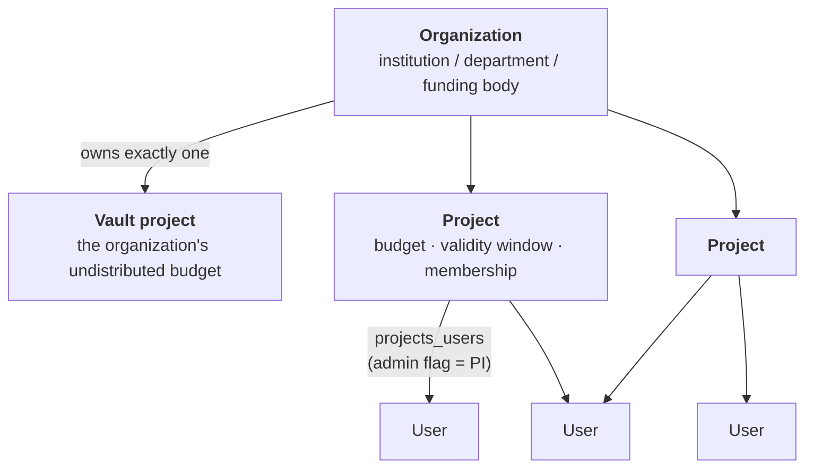
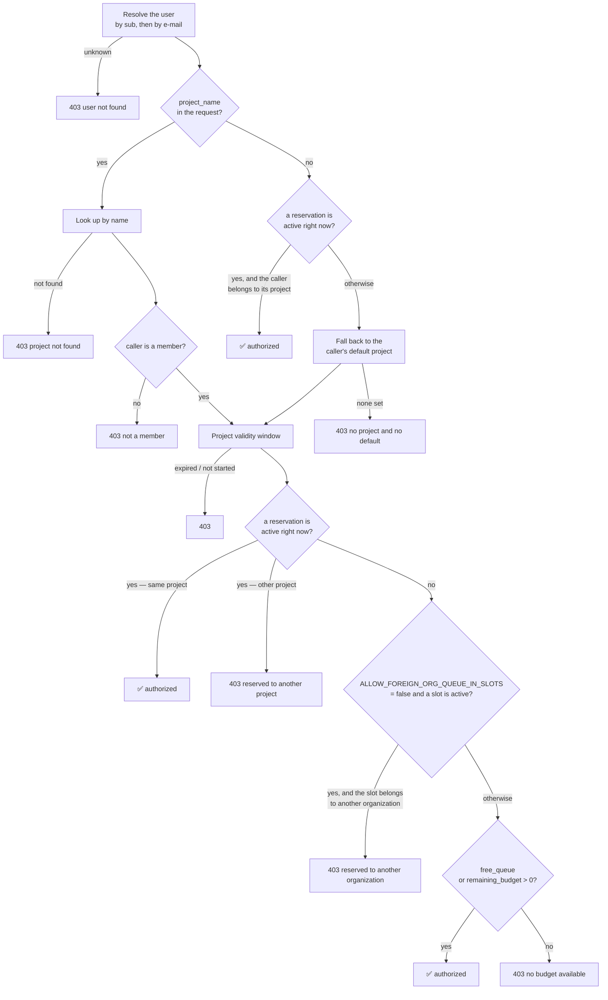

# Tenancy, budgets and billing

This is the model that makes a shared quantum computer accountable. Every rule
here is enforced in quantum-api, and every balance change is backed by a ledger
entry.

## The tenancy hierarchy

**Organization** — the funded entity. Holds a name, an optional
`reference_organization_id` (a pointer to a parent/umbrella organization, used
when granting one organization access to another's allocated time), and exactly
one **vault project**.

**Vault project** — created automatically with the organization. It is a normal
project row that holds the organization's *undistributed* budget. Creating an
organization with an initial budget of N hours creates the vault with N hours
credited and a ledger entry recording it. Every project the organization creates
is funded **out of the vault**, so an organization can never over-allocate: if
the vault does not have the requested budget, project creation fails with the
available amount in the error.

**Project** — the unit of access and accounting:

| Field | Meaning |
|---|---|
| `name` | Unique platform-wide. This is the string users pass as `project_name` in a submission. |
| `remaining_budget` | QPU-milliseconds available. `BIGINT`. |
| `start_at` / `end_at` | Optional validity window. Submissions outside it are refused. |
| `free_queue` | When true, the project is **never billed** and its budget is not consulted. For open-access queues, teaching, and testing. |
| `organization_id` | Owning organization. |

**Membership** — `projects_users` links users to projects, with an `admin` flag.
A user with `admin = true` on a project is its **principal investigator (PI)**:
they can manage its membership and place reservations for it. A user has an
optional **default project**, used when a submission does not name one.

## Budgets are QPU-milliseconds, and only the ledger moves them

Budgets are denominated in **milliseconds of quantum-processor execution time**.
Not shots, not wall-clock, not jobs: the execution window the machine reports for
a job.

Every change to `projects.remaining_budget` is accompanied by a row in
`budget_events`, in the same database transaction:

| Field | Meaning |
|---|---|
| `project_id` | Affected project. |
| `value` | Signed QPU-milliseconds. Negative = consumed or transferred out. |
| `date` | When it happened. |
| `description` | Human-readable provenance ("Job `<jobid>` …", "reservation 17 …", "transferred to project X"). |
| `billing` | Whether the entry counts as billable consumption, as opposed to an administrative movement. |

This ledger — not the balance — is what usage and billing reports are built
from. The balance is a cached sum; the ledger is the record.

### What creates ledger entries

| Operation | Entries | Notes |
|---|---|---|
| **Create organization** with initial budget | `+N` on the vault project | "vault creation" |
| **Create project** with budget drawn from the vault | `-N` on the vault, `+N` on the new project | Refused if the vault is short. |
| **Transfer budget** between two projects of one organization (`POST /api/organizations/{id}/budgetTransfer`) | `-N` on the source, `+N` on the destination | Both projects must belong to the organization. |
| **Create reservation** | `-duration` on the project | Charged **up front**, at the full reserved duration. |
| **Delete a future reservation** | `+refund` on the project | 100 % if more than 24 h ahead, otherwise 25 % (`round(ms/4)`). |
| **Job reaches a terminal state** | `-(execution_end − execution_start)` on the project, `billing = true` | Skipped for `free_queue` projects and for jobs flagged as running inside a reservation. |

### Job billing, precisely

Billing happens in one place: the terminal `PUT /jobReport/{jobid}` from the
gateway's reporter. Inside a single transaction, the backend:

1. loads the job by its vendor job id — `404` if unknown;
2. **returns early if the job already has both `execution_start` and
   `execution_end`**, which makes the terminal report idempotent: a duplicate
   report cannot double-bill;
3. updates status, execution window, results pointer;
4. bills, if and only if **all** of the following hold:
    - the project is not `free_queue`,
    - both `execution_start` and `execution_end` are present in this report,
    - the job is not flagged `usedReservation`;
5. appends the `budget_events` row.

The amount is exactly `execution_end − execution_start` in milliseconds, as
reported by the gateway from the machine's own timeline. A project can go
negative — nothing clamps the balance at zero, because the check that stops
submissions happens *before* the job runs, and a long job can overshoot the
remaining budget. Whether to top up or write off an overdraft is an operator
decision.

## Slots and reservations

Two distinct concepts, often confused:

- A **slot** is a window of machine time *allocated to an organization*, created
  by a platform administrator. It does not book anything; it delimits where that
  organization's projects are allowed to book.
- A **reservation** is a window of *exclusive access for one project*, created by
  that project's PI (or an administrator) and paid for from the project's budget
  at creation time.

```mermaid
gantt
    dateFormat HH:mm
    axisFormat %H:%M
    title A day on the machine
    section Organization A slot
    Slot allocated to Org A        :done, 09:00, 4h
    Reservation — project alpha    :active, 09:30, 1h
    Reservation — project beta     :active, 11:00, 1h30m
    section Open queue
    Anyone with budget             :12:00, 21h
```

While a reservation is active, **only the reserving project may submit** —
enforced independently of slots, so reservations placed outside any slot are
still exclusive. Outside reservations, the machine runs an **open queue**: any
project with budget (or `free_queue`) may submit, first-come-first-served,
subject to the gateway's concurrency limits.

### Reservation rules at creation

- The requested window must satisfy a minimum duration and must not overlap an
  existing reservation.
- It must fall inside the project's validity window.
- The project must have at least the full duration available in its budget; the
  amount is debited immediately.
- **If `SLOT_CONSTRAINED_RESERVATIONS` is true** (the default), a `slot_id` is
  required, the slot must belong to the project's organization — or to the
  organization it references — and the reservation must fit inside the slot.
  **If false**, `slot_id` is optional and reservations are placed freely on the
  calendar.
- Reservations are not editable: `PUT` is not supported. Delete and recreate,
  keeping the refund rule in mind.

### Two deployment policies worth understanding

Both default to the historical behaviour, so an existing deployment is unaffected
by upgrading.

**`SLOT_CONSTRAINED_RESERVATIONS`** (default `true`) — whether the slot layer
exists at all from the users' point of view. Set it to `false` for a deployment
that has no organization-level allocation to manage: reservations become free
placements on the calendar and the dashboard hides the slot views (it learns this
from `GET /config`).

**`ALLOW_FOREIGN_ORG_QUEUE_IN_SLOTS`** (default `true`) — what the open queue
means *during* another organization's slot, outside any reservation. With `true`,
an allocated-but-unreserved slot does not stop anyone else from using the idle
machine. With `false`, the slot is effectively exclusive to its organization (and
to organizations referencing it) even when nobody has reserved it.

## Authorization of a submission

This is `POST /jobAuthorizer`, and it is the rule set that decides whether a
circuit is allowed to run. In order:

Notes that matter in practice:

- **An active reservation always wins.** Even a project with budget and a valid
  default project is refused while somebody else's reservation is running.
- **The budget check is `> 0`, not "enough for this job".** The platform cannot
  know a circuit's execution time before it runs, so it admits any submission
  from a project with a positive balance. Overdraft is possible by design; see
  [job billing](#job-billing-precisely).
- **A reservation you belong to short-circuits the whole check** when no
  `project_name` was given: the reservation is already paid for.
- **Denials are explanatory.** Every `403` carries a human-readable reason, which
  the gateway passes back to the client. This is the main diagnostic when a user
  reports "my circuit was refused".

## Attribution when the job is recorded

`POST /jobReport` decides which project a job is attributed to, and it does so
independently of the authorization call. Given the reported `username` and the
submission timestamp:

1. the user is resolved by e-mail — unknown user is a `400` and an audit-log
   `reportingError`;
2. the project defaults to the user's **default project**;
3. if a **reservation covering the submission time** exists and the user belongs
   to its project, that project is used instead and the job is flagged
   `usedReservation` — which is what exempts it from being billed again;
4. if the report carries an explicit **`project_name`**, that project wins.

The resulting job row records the project, the organization, the user, the vendor
job id, the status, the execution window, the submitted-circuit and results
pointers, the job type, and the `usedReservation` flag.

!!! note "`free_queue` accounting"
    Free-queue projects are never debited, but their jobs are still recorded in
    full. The `total_freequeue_time` field on a project is a computed (virtual)
    value, so free-queue usage can be reported on even though it never moves the
    ledger.
