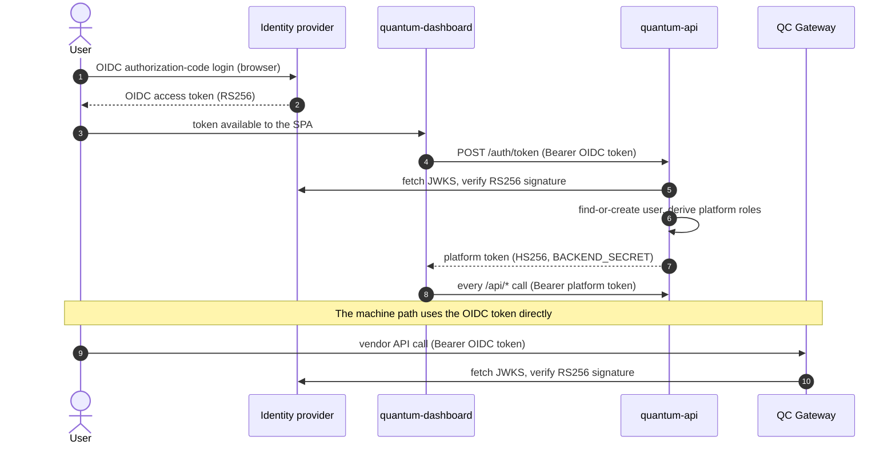

# Identity and authorization

Authorization in this stack is answered in three different places, with three
different notions of "role". Getting them straight is the single most useful
thing to understand before deploying or extending anything.

| Where | Question it answers | Role vocabulary | Source of truth |
|---|---|---|---|
| **Identity provider** | Who is this? What is this account entitled to at the machine? | Realm roles (`cortex_user`, `pulla_user`, `platform-admin`, `platform-ro-admin`) | The IdP |
| **QC Gateway** | May this identity call this vendor route? | The same realm roles, matched against the vendor plugin's route table | Token claims (or `GET /userRoles`) |
| **quantum-api** | May this identity read/modify this resource? May this submission run against this project? | Platform roles (`admin`, `readOnlyAdmin`, `organization-manager`, `organization-auditor`, `project-admin`, `impersonator`) | The backend database, derived at login |

The two vocabularies are deliberately separate: the first governs *the machine*,
the second governs *the platform*. A user can be a platform administrator with no
ability to submit circuits, and vice versa.

## Tokens

Two token types circulate. They are not interchangeable.



**OIDC access token** — issued by the identity provider, signed RS256, validated
against the IdP's JWKS endpoint. Accepted by:

- the **gateway**, on every request to the machine;
- the **backend**, only at `POST /auth/token` and `POST /jobAuthorizer`.

**Platform token** — issued by `POST /auth/token`, signed **HS256 with
`BACKEND_SECRET`**, default lifetime 24 h (`TOKEN_DURATION`). Required by every
`/api/*` route. Its payload is the authorization context:

```json
{
  "id": 42,
  "sub": "<oidc subject>",
  "email": "user@example.org",
  "name": "Example User",
  "roles": ["admin", "impersonator"],
  "organization": { "id": 1, "name": "ExampleOrg" },
  "administeredProjects": [7, 12]
}
```

!!! warning "`BACKEND_SECRET` is a symmetric signing key"
    Anything holding `BACKEND_SECRET` can mint a token with `roles: ["admin"]`.
    It belongs to quantum-api alone: never distribute it to another service, and
    never hand a `BACKEND_SECRET`-signed token to a client as a way of granting
    machine-to-machine access. For service-to-service calls, use a separately
    authenticated identity — see [Gateway ↔ backend
    contract](../reference/machine-endpoints.md#authentication-status-and-hardening).

## Realm roles: what the identity provider must provide

The stack expects these realm roles to exist. Names are conventional rather than
hardcoded — see the note on renaming below.

| Realm role | Grants |
|---|---|
| `cortex_user` | Circuit submission and job inspection through the gateway. The baseline "may use the machine" role. |
| `pulla_user` | Sweep / pulse-level submission ("Pulse access" in the dashboard). A superset capability, granted selectively. The realm role *seeds* the platform's own record of the grant when a user is first registered; from then on the platform decides — see [Platform roles](#platform-roles-how-the-backend-derives-them). |
| `platform-admin` | Full platform administration in the dashboard and API (mapped to `admin` + `impersonator`). |
| `platform-ro-admin` | Read-only platform administration (mapped to `readOnlyAdmin`). |

Additionally the IdP must be configured so that:

- **the username is the user's e-mail address** in the default configuration.
  The backend matches identities by e-mail (`users.email`) and the gateway
  reports it as the job's `username`. If your identities are not e-mail
  addresses, set `USERNAME_FORMAT=any` **before first boot** — see
  [configuration](../reference/configuration.md#username_format).
- **the `sub` claim is stable.** On first login the backend records it and
  thereafter matches on it, falling back to e-mail once to attach the `sub` to a
  pre-created user row.
- **two public clients exist**: one for the dashboard (authorization-code flow)
  and one used to obtain a token for the machine/SDK path. A single client can
  serve both, but separating them keeps redirect URIs and token audiences
  tidy.

See [Identity provider](../components/identity-provider.md) for a concrete
Keycloak setup, including a bootstrap script.

!!! info "The role names come from the vendor, and are not hardcoded in the core"
    `cortex_user` and `pulla_user` are named after the IQM control-software
    components they gate. The gateway core knows nothing about them: they appear
    only in the **vendor plugin's route table**, which maps
    `(path, method) → [required roles]`. Renaming them is a change to that table
    (and to the realm), not to the core. The one place a role name is baked into
    the backend is `PULSE_ACCESS_OIDC_ROLE`, which is configurable precisely
    because realms name it differently.

## Gateway authorization

Two independent gates, in this order.

**1. Route whitelist.** A request whose `(path, method)` is not in the vendor
plugin's route table is rejected with `403` before authentication is even
considered. There is no default-allow. Alongside the role-gated table the plugin
declares:

- **public routes** — bypass authentication entirely (health, metrics, and the
  proxy's own config endpoint);
- **logged routes** — submissions that must be recorded;
- **deprecated routes** — answered `410 Gone`, used to retire vendor endpoints
  the platform does not want reachable.

**2. Role check.** `RoleAuthorizationChecker` requires the token to carry one of
the roles the table lists for that route. The reference IQM table:

| Route | Method | Required role |
|---|---|---|
| `/api/v1/jobs/default/circuit` | any | `cortex_user` |
| `/api/v1/jobs/default/run` | any | `cortex_user` |
| `/api/v1/jobs` | `GET`, `DELETE` | `cortex_user` |
| `/api/v1/jobs/{job_id}/cancel` | `POST` | `cortex_user` |
| `/api/v1/calibration-sets/default` | `GET` | `cortex_user` |
| `/api/v1/quantum-computers` | `GET` | `cortex_user` |

Note that the sweep route asks only for `cortex_user`. Pulse access is not a
role check at the gateway: the vendor plugin classifies the request from its path
(`circuit` or `sweep`) and passes that verdict to the backend, which answers from
the platform's own record of the grant. The role table cannot express "this user
may sweep" for a principal whose credential carries no roles at all, and a realm
role cannot be revoked by an administrator working in the dashboard — both are
reasons the decision moved.

Beyond roles, then, the gateway asks the backend whether *this* submission is
allowed (pulse access, project membership, budget, reservations) — that is
[`/jobAuthorizer`](../reference/machine-endpoints.md#post-jobauthorizer), and it
runs only in `production` mode. Then it applies its own per-user concurrency
limits. Both are covered in [Life of a job](job-lifecycle.md).

## Platform roles: how the backend derives them

At `POST /auth/token`, after verifying the OIDC token, the backend builds the
role list from two sources — the token's realm roles and the database:

| Platform role | Derived from | Meaning |
|---|---|---|
| `admin` | realm role `platform-admin` | Full read/write administration. |
| `impersonator` | realm role `platform-admin` | May act on behalf of another user where the API supports it. |
| `readOnlyAdmin` | realm role `platform-ro-admin` | Sees everything an `admin` sees; mutations are refused. |
| `organization-manager` | `users.organization_manager` | Manages projects and users **within their own organization**. |
| `organization-auditor` | `users.organization_auditor` | Read-only visibility over their own organization. |
| `project-admin` | any `projects_users` row with `admin = true` | Principal investigator of one or more projects: manages membership and reservations for the projects listed in `administeredProjects`. |

The mapping from realm roles to platform roles is currently **fixed in code**
(`src/routes/token.ts`); the organization- and project-scoped roles come from the
database and are managed through the dashboard. Making the claim→role mapping
configurable is on the roadmap.

Two side effects of the exchange are worth knowing about:

- **Auto-provisioning.** A successful exchange for an unknown identity *creates*
  the user row, with no organization, no project and no budget. Such a user can
  log in and see an empty dashboard, and cannot submit anything until an
  administrator places them in a project. This is intentional: it lets a
  deployment federate a whole institution's identity provider without
  pre-registering everyone.
- **Pulse-access seeding.** When the exchange *creates* the user row, the realm
  role named by `PULSE_ACCESS_OIDC_ROLE` (default `pulla_user`) sets
  `users.pulla_user`, so an identity starts with the access the realm already
  gives it. This happens at registration only. Afterwards the flag belongs to
  the platform: an administrator grants or revokes it in the dashboard, and a
  later login neither restores nor removes it. An account that gains the realm
  role after its first login is granted Pulse access by an administrator, not
  automatically.

## Resource authorization in the backend

Every `/api/*` route sits behind `authenticateJWT` (verify the platform token,
populate `req.user`) and then one or more scoping middlewares:

| Middleware | Enforces |
|---|---|
| `authorizeByRole` | Caller holds one of the listed platform roles. |
| `authorizeByProjectAdmin` | Caller administers the project named in the request. |
| `restrictToOrganization` / `restrictOrganization` | Query and mutation are confined to the caller's organization. |
| `restrictToUser` | Query and mutation are confined to the caller's own records. |

The effective visibility rules, stated as a matrix:

| Scope | `admin` / `readOnlyAdmin` | `organization-manager` | `organization-auditor` | `project-admin` | plain user |
|---|---|---|---|---|---|
| Organizations | all | own (read) | own (read) | — | — |
| Projects | all | own organization | own organization (read) | administered | member-of (read) |
| Users | all | own organization | own organization (read) | project members (read) | self |
| Project membership | all | own organization | — | administered | — |
| Slots | all | — | — | — | — |
| Reservations | all | own organization | own organization (read) | administered | member-of (read) |
| Jobs | all | own organization | own organization | administered projects | own |
| Budget events / ledger | all | own organization | own organization | administered projects | own projects |
| Announcements | all (write) | read | read | read | read |
| Audit log | all | — | — | — | — |

`readOnlyAdmin` mirrors `admin` for reads and is refused on writes. The
dashboard's `authProvider.canAccess()` hides what a role cannot use, but the
enforcement that matters is the backend's — the UI is a convenience, not a
control.

## Identity on paths where the token carries no roles

Some deployments authenticate principals that are not IdP users at all — for
example a batch-scheduler job running as a cluster account. Such a principal is
authenticated by a different mechanism (a gateway auth plugin), and its
credential carries no realm roles.

For these, the gateway resolves platform capability from the backend instead:

```
GET /userRoles/{username}  →  200 { "username": "...", "roles": ["cortex_user", "pulla_user"] }
                              404 if the identity is unknown
```

The response is derived from the user row: `cortex_user` for any known user, plus
`pulla_user` when the `pulla_user` flag is set — the same flag
[`/jobAuthorizer`](../reference/machine-endpoints.md#post-jobauthorizer) consults
for a sweep, so an identity gets the same capability whichever way it
authenticates. See the
[contract reference](../reference/machine-endpoints.md#get-userrolesusername).

## Auditing

Two independent trails, and they answer different questions:

- **`action_logs`** in the backend — administrative and account activity: logins,
  user creation, role changes, budget transfers, reservation deletions,
  reporting errors. Written by `logToDatabase()` at the point of the change, with
  the acting user, resource, resource id and a human-readable description.
  Readable by platform administrators at `/api/logs`.
- **Job records and archived payloads** in the data plane — every submission's
  payload in object storage, every job's lifecycle in the gateway's job log and
  in the backend's `jobs` table, every billing entry in `budget_events`.

Together they are what makes a usage claim defensible: the ledger says how much
was billed, the job row says which execution window it was billed for, and the
archived payload says what was actually run.
