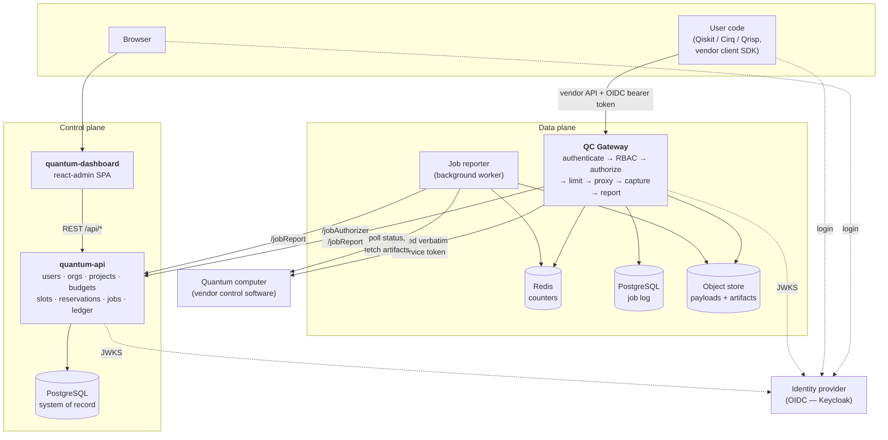
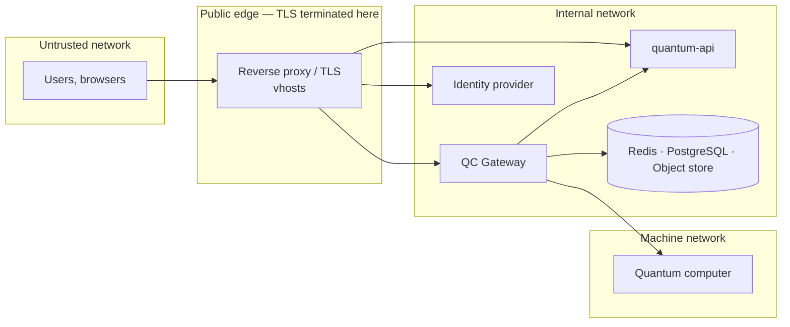
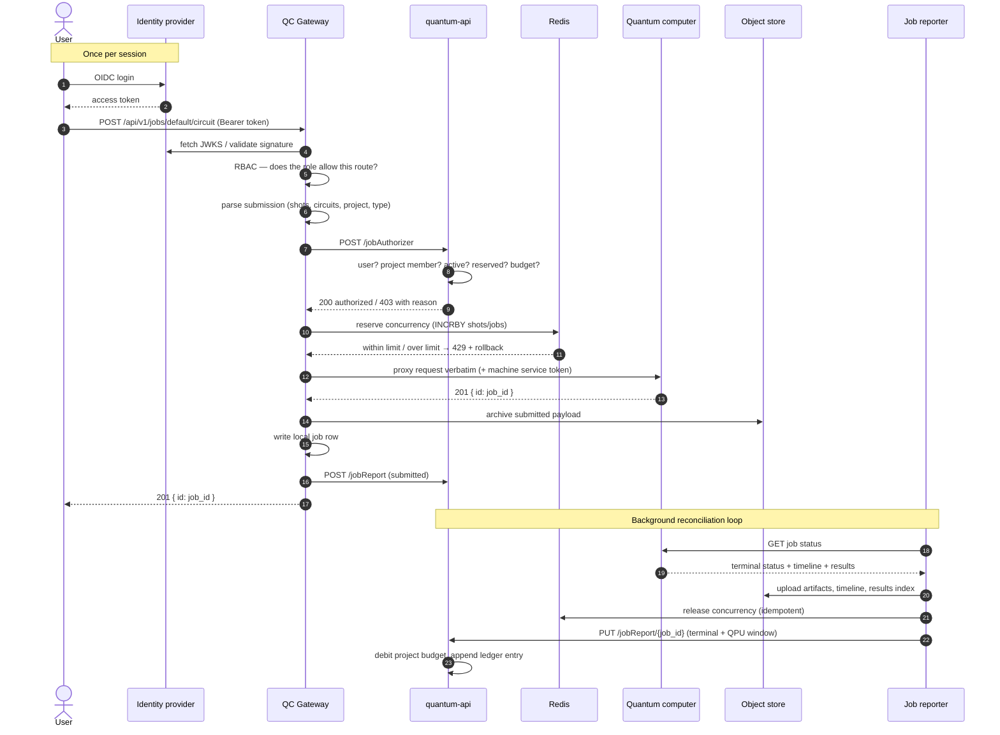

# Architecture

## The problem the stack solves

A quantum computer is a single, indivisible, expensive instrument. Vendor
control software typically assumes one operator and offers a service token, or
at best a flat list of users. Operating the machine as a shared research
facility needs a layer the vendor does not provide:

- **Identity** — real people, authenticated against an institutional identity
  provider, not a shared token.
- **Tenancy** — organizations, projects, and membership, so that access can be
  granted and revoked at the granularity funding is granted.
- **Accounting** — a defensible answer to "who used how much QPU time, against
  which project, and when", down to a per-job ledger entry.
- **Fair use** — nobody can monopolise a machine that executes one circuit at a
  time.
- **Exclusive access** — some work (calibration campaigns, demonstrations,
  paid-for blocks) needs the machine to itself for a window of time.
- **Auditability** — every submission archived, every artifact retained, every
  administrative action logged.

…and it needs all of it *without* asking users to adopt a new SDK. Researchers
arrive with Qiskit, Cirq or Qrisp code written against the vendor API, and the
platform must be invisible to it.

## Control plane and data plane

The stack splits along that seam. **Circuits** flow through the QC Gateway;
**decisions and records** live in quantum-api.

Consequences of that split worth understanding before reading further:

- **The gateway never owns policy.** It asks. Whether a submission is allowed is
  a question answered by `POST /jobAuthorizer` in the backend, which consults
  project membership, project validity dates, active reservations, slot rules
  and remaining budget. The gateway only enforces what it is told, plus its own
  concurrency limits.
- **The backend never sees a circuit execute.** It learns about jobs from the
  gateway's reports, and bills on the final one. Its notion of "QPU time" is
  whatever the gateway reported as `execution_start`/`execution_end`.
- **Neither service stores passwords.** Both validate JWTs issued by the identity
  provider against its JWKS endpoint.
- **The two databases are separate on purpose.** The gateway's PostgreSQL is an
  operational job log local to the data plane; the backend's PostgreSQL is the
  system of record. A gateway can be rebuilt from scratch without touching
  accounting data.

## Trust boundaries

Three properties of this layout are load-bearing:

1. **The machine is never directly reachable.** The only route to it is through
   the gateway, which is the only holder of the machine's service token. Users
   authenticate as themselves; the machine sees one service identity.
2. **The backend's machine endpoints are internal.** `/jobAuthorizer`,
   `/jobReport` and `/userRoles` are the gateway-to-backend contract and are
   expected to be reachable only from the gateway. See
   [Gateway ↔ backend contract](../reference/machine-endpoints.md) for exactly
   what each one trusts today — this is the part of the stack you should review
   most carefully before exposing a deployment.
3. **The browser never talks to the gateway.** The dashboard talks only to
   quantum-api. The gateway serves machine traffic, plus a static jobs-results
   viewer.

## End-to-end: a circuit submission

The full path, with the two reference plugins (IQM as vendor, a portal-backed
site plugin talking to quantum-api):

Read [Life of a job](job-lifecycle.md) for the failure modes, the rollback
rules, and what is idempotent.

## Design rules

These are the invariants the codebase is held to. They are worth knowing because
they explain most of the structure you will find.

### The vendor API is preserved on the wire

The gateway passes paths, bodies, headers and status codes through unchanged.
The vendor plugin parses requests *for bookkeeping* — how many shots, which
project, is this a circuit or a sweep — and never rewrites them. This is what
makes existing SDKs work with nothing but a URL change, and it means the gateway
never has to track vendor API drift in a translation layer.

### Vendor and site specifics live in plugins

The gateway core may not import from `middleware.vendors.*` or
`middleware.sites.*`, and may not branch on a vendor or site name. Two `Protocol`
contracts define the seams:

- `VendorPlugin` — the route table and its role requirements, request/response
  parsing, upstream auth headers, job-status polling, artifact classification,
  calibration handling.
- `SitePlugin` — job authorization and job reporting against whatever the site
  uses as its portal, plus results-URL construction.

Both are selected by environment variable and resolved through a registry. See
[Extending the stack](../development/extending.md).

### Fail open on non-critical paths, fail closed on authorization

Redis, object storage and portal hiccups are logged and the request continues:
losing a counter or an archived payload is worse than losing the job, but not
much worse. Authentication and authorization failures always short-circuit. This
asymmetry is deliberate and is stated as a rule in the gateway's `CLAUDE.md`.

### Money is QPU-time, and it only moves through the ledger

Budgets are denominated in **QPU-milliseconds**. A project's
`remaining_budget` is never mutated without appending the `budget_events` row
that explains the change. Reports, invoices and audits are built from the ledger,
not from the balance. See [Tenancy, budgets and billing](accounting.md).

### New behaviour ships behind a flag whose default changes nothing

Every configurable behaviour added to the backend has a default that reproduces
the previous behaviour, so a new version can be rolled onto a running deployment
without changing what it does. `SLOT_CONSTRAINED_RESERVATIONS`,
`ALLOW_FOREIGN_ORG_QUEUE_IN_SLOTS`, `USERNAME_FORMAT` and
`PULSE_ACCESS_OIDC_ROLE` all follow this rule; see the
[configuration reference](../reference/configuration.md).

### Layers in the backend point one way

`routes → middleware → controllers → services → repositories → models`.
Controllers are thin adapters; business logic is in services; only repositories
touch Sequelize. Any schema change arrives with its migration in the same commit.
