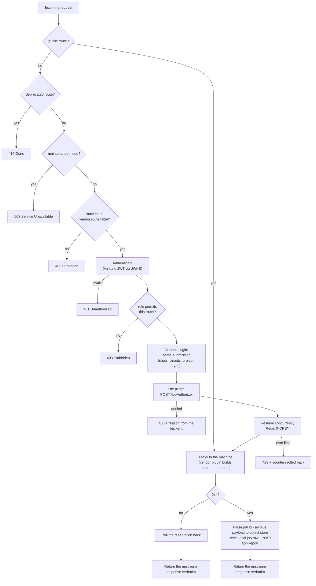
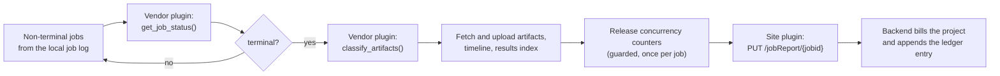

# Life of a job

What happens between a user calling `provider.get_backend().run(circuit)` and a
line appearing in the billing ledger. This page is the operational counterpart to
[Architecture](index.md): it covers ordering, failure handling, and what is safe
to retry.

## The gateway's operation modes

Everything below describes `production`. The mode is chosen with
`MIDDLEWARE_MODE` and changes which stages run:

| Mode | Authentication | Site authorization | Concurrency limits | Reporting | Proxying |
|---|---|---|---|---|---|
| `production` | ✅ | ✅ | ✅ | ✅ | ✅ |
| `authentication` | ✅ | — | — | — | ✅ |
| `reporting` | ✅ | — | — | ✅ | ✅ |
| `maintenance` | — | — | — | — | ❌ — everything answers `503` |

`authentication` is useful for bringing a deployment up before the backend
exists, `reporting` for mirroring traffic into the accounting system without
enforcing policy, and `maintenance` for planned downtime — it is what an operator
switches on before touching the machine.

## The hot path

One FastAPI middleware — `proxy_and_capture` — implements the whole request
pipeline. The order is load-bearing; changing it is treated as a significant
change in the gateway's own contribution rules.

Points worth internalising:

- **The response is always the machine's response.** The gateway does not
  reshape success bodies. Its own failures are the only non-vendor responses a
  client sees, and they carry the reason.
- **Parsing is for bookkeeping only.** The body forwarded upstream is the body the
  client sent.
- **Authorization precedes the reservation, which precedes the proxy.** So a
  denied submission costs no counter, and a rejected upstream request does not
  leave one behind.
- **Only submissions are authorized and counted.** Status polls, cancellations and
  calibration reads pass through with authentication and RBAC only.

## Concurrency limiting

The machine executes one circuit at a time. Without a limit, one user submitting
a thousand circuits makes the machine unusable for everyone else for hours. The
limiter is a fairness device, not a security control.

Two per-user counters in Redis, both with a TTL (default 1 h) so a crashed
reporter cannot poison a user's quota forever:

| Key | Counts | Limit |
|---|---|---|
| `shots:active:<username>` | `shots × circuits` currently in flight | `MAX_CONCURRENT_SHOTS` |
| `jobs:active:<username>` | submissions currently in flight | `MAX_CONCURRENT_SWEEPS` |

Shots are the meaningful unit for circuit submissions. For sweeps — where the
shot count cannot be reliably extracted from the payload — the job counter is
used instead. Reservation is a pre-increment followed by a limit check: over the
limit, the increment is undone and the client gets `429`.

If Redis is unavailable the limiter **fails open** and admits the submission. A
lost counter is preferable to an outage, and the authoritative accounting is in
the backend regardless.

## Capture on success

Once the machine has accepted the submission and returned a job id:

1. **The submitted payload is archived** to object storage, keyed by job id. This
   is the "what was actually run" record, and it is what makes a usage dispute
   answerable.
2. **A row is written to the gateway's own PostgreSQL job log** — the operational
   view of in-flight work, independent of the backend.
3. **An initial `POST /jobReport`** registers the job with the backend, which
   resolves the project and creates the accounting row (see
   [attribution](accounting.md#attribution-when-the-job-is-recorded)).

All three are best-effort: a failure is logged and the client still gets its job
id. The reconciliation loop repairs what it can.

## Background reconciliation

The **reporter** is the same image as the proxy, run as a second process. It
loads the same vendor and site plugins and loops every
`JOB_REPORTER_INTERVAL` seconds over jobs that are not yet in a terminal state:

Alongside the job loop it runs vendor-specific work — for IQM, polling
calibration runs and attaching calibration data to job artifacts.

### What is idempotent, and how

Reconciliation retries, so double-counting has to be impossible in two places:

- **Counter release** is guarded by a Redis set, `jobs:terminal:processed`, with a
  3-day TTL. `SADD` returns whether the job id was new; only a genuinely new
  entry decrements `jobs:active:*` and `shots:active:*`. A crash between the two
  therefore cannot decrement twice.
- **Billing** is guarded in the backend: the terminal `PUT /jobReport/{jobid}`
  returns early if the job already has both `execution_start` and
  `execution_end`. A duplicate terminal report is a no-op, not a second debit.

Between them, the reporter can crash and restart at any point without corrupting
either the fairness counters or the ledger.

## Failure modes and what they look like

| Failure | Client sees | Consequence |
|---|---|---|
| Invalid or expired token | `401` | None. |
| Route not in the vendor table | `403` | None. Add it to the vendor plugin if it should be reachable. |
| Role missing | `403` | None. Grant the realm role. |
| Backend denies the submission | `403` with the backend's reason | None. The reason is the diagnostic — see [authorization](accounting.md#authorization-of-a-submission). |
| Concurrency limit exceeded | `429` | Counters rolled back. Client should retry later. |
| Backend unreachable at `/jobAuthorizer` | `403` | Submissions stop while the backend is down: authorization fails closed. |
| Machine returns non-2xx | The machine's response, verbatim | Reservation rolled back; no job row created. |
| Object store unavailable | `2xx`, job proceeds | Payload not archived; logged. |
| Redis unavailable | `2xx`, job proceeds | No limit enforced while it is down; logged. |
| `POST /jobReport` fails | `2xx`, job proceeds | The backend has no record yet. The terminal `PUT` will `404`; the job is not billed. Reconcile manually if it matters. |
| Reporter down | Nothing — the client polls the machine directly | Jobs stay non-terminal in the accounting system, counters expire by TTL, nothing is billed until the reporter returns. It catches up on restart. |

The pattern: **authorization fails closed, bookkeeping fails open**. A backend
outage stops new work rather than letting unbilled work through; storage and
counter outages degrade record-keeping rather than blocking the machine.

## Observability

- **Prometheus metrics.** The gateway exposes gauges built by scanning the Redis
  counters — per-user and total active jobs — suitable for a queue-depth
  dashboard. `/metrics` is a public route.
- **Job records.** The gateway's own PostgreSQL is the operational view; the
  backend's `jobs` table is the accounting view; `GET /metrics/jobs` on the
  backend exposes job counters in Prometheus form.
- **Results portal.** Uploaded artifacts are indexed into a static viewer served
  from the gateway host, and the URL is what the backend stores as the job's
  results pointer — so a job row in the dashboard links to its artifacts.
- **Audit log.** Reporting anomalies (unknown user, unknown project, duplicate
  terminal report) are written to the backend's `action_logs` as
  `reportingError` / `reportingWarning` entries. That table is the first place to
  look when a job exists on the machine but not in the accounting system.
