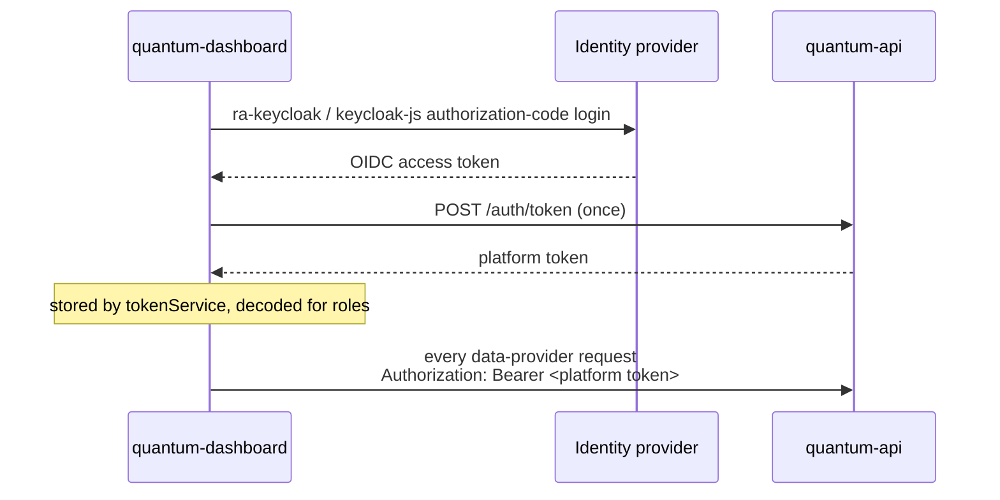

# quantum-dashboard

The management web UI. React 19 · TypeScript · Vite · react-admin 5 on MUI ·
EUPL-1.2 · [source on GitHub](https://github.com/LINKS-Foundation-CPE/Lagrange-Dashboard).

A single-page application over [quantum-api](quantum-api.md). Operators use it to
manage organizations, projects, budgets, slots, reservations and users; principal
investigators to manage their own projects; end users to see their projects,
budgets, reservations and job history.

It holds **no authorization logic of its own that matters**: `canAccess()` hides
what a role cannot use, but the enforcement is the backend's. Treat the UI as a
convenience.

## What a user sees

The sidebar is sectioned by role. Everything above the "Admin" header is available
to everyone; the admin section appears only for accounts with some administrative
capability.

| Item | Visible to |
|---|---|
| Dashboard (landing) | everyone |
| My Projects | everyone |
| My Jobs | everyone |
| Machine Status, Machine Metrics | everyone, where the deployment sets their URLs |
| Documentation | everyone, where the deployment sets `VITE_DOCS_URL` |
| **Admin** — Reservations, Reservations Calendar | platform admins, organization managers, project admins |
| **Admin** — Projects | platform admins, organization managers, project admins (rows scoped by the backend) |
| **Admin** — Users | platform admins, organization managers |
| **Admin** — All Jobs | platform admins |
| **Admin** — Allocated slots, Slots Calendar | platform admins, and only when the deployment is slot-constrained |
| **Admin** — Billing reports | platform admins, organization managers, organization auditors |
| **Admin** — Organizations, Tags, Logs, Announcements | platform admins |

Plus custom pages: the landing dashboard, the two calendars (on
`react-big-calendar`), the billing reports page, the two monitoring panels, and a
self-service **Profile** over `/api/own` where a user sets their default project
and can obtain a token for the machine/SDK path.

For what each page actually does, page by page, see
[Using the portal](../using/index.md).

The slot views are driven by the backend's public `GET /config`: when a deployment
runs with `SLOT_CONSTRAINED_RESERVATIONS=false`, they disappear rather than showing
an empty concept. This is the pattern to follow for any future UI that depends on a
deployment flag.

### Monitoring panels

**Machine Metrics** frames the deployment's monitoring overview page. **Machine
Status** does *not* frame the status site: it renders native cards from that
site's per-monitor badge endpoints, which are SVG **images** and therefore exempt
from CORS — the status host opens its JSON API to no other origin, so this needs
no proxy and no gateway change, and the badges are rendered by the status site
itself so the panel cannot drift from it. Framing the whole site brought its
navigation along and its links had nowhere to go inside a panel.

Each panel carries an "Open in new tab" link, because an embedded page that
misbehaves in a frame should still be one click from useful. The routes stay
registered when the URLs are unset and report themselves unconfigured, so a stale
bookmark says so rather than dead-ending.

### Theme

The portal carries the **Lagrange palette** — the same one the login screen uses,
so a user meets one brand before and after signing in. It is written as MUI
`ThemeOptions` merged onto react-admin's `defaultTheme`, so nothing the framework
relies on is replaced and no dependency is added: react-admin renders MUI, and a
Bootstrap-based admin template could not be applied without abandoning its
rendering entirely.

The theme is also where cross-cutting list defaults live. Lists show **25 rows per
page** because `<List>` reads its props through MUI's `useThemeProps`, so a
`RaList` default prop reaches every list in the app — including ones added later,
which a per-list prop would miss.

## How it authenticates



- `authProvider.ts` — OIDC login via `ra-keycloak`; `canAccess()` maps roles to
  resource visibility.
- `dataProvider.ts` — `ra-data-simple-rest` against `VITE_API_URL`, with a custom
  `httpClient` that attaches the platform token.
- `fetchBackendTokenOnce.ts` and `services/`, `hooks/` — one-shot token exchange,
  storage, and the `useBackendToken()` hook that the menu and pages read roles
  from.

The platform token's payload *is* the client-side authorization context: `roles`,
`organization`, `administeredProjects`. See
[Identity and authorization](../architecture/identity.md#tokens).

## Layout

```
src/
├── App.tsx              # <Admin> + one <Resource> per backend entity, + <CustomRoutes>
├── Layout.tsx           # app shell
├── CustomAppBar.tsx     # top bar
├── CustomMenu.tsx       # role-sectioned navigation
├── authProvider.ts      # OIDC login, canAccess()
├── dataProvider.ts      # ra-data-simple-rest + platform token
├── fetchBackendTokenOnce.ts
├── hooks/               # useBackendToken, useConfig, batch user creation
├── services/            # token service and API helpers
└── pages/<resource>/    # List / Show / Edit / Create per entity, plus
                         #   my-projects, my-jobs, calendar, profile, dashboard
```

Resources map one-to-one onto backend entities: organizations (with nested user
and project views), users, projects (with membership management and bulk add),
slots, reservations, jobs, action logs, announcements, notifications.

## Build and configuration

```bash
npm install
cp .env.example .env
npm run dev       # Vite dev server with hot reload
npm run build     # static assets into dist/
npm run serve     # preview the production build
```

Configuration is `VITE_*` variables and is **baked in at build time** — changing
one means rebuilding, not restarting:

| Variable | Purpose |
|---|---|
| `VITE_API_URL` | quantum-api REST base URL (`https://<api>/api`) |
| `VITE_TOKEN_URL` | token-exchange endpoint (`https://<api>/auth/token`) |
| `VITE_KEYCLOAK_URL` | identity-provider base URL |
| `VITE_KEYCLOAK_REALM` | realm |
| `VITE_KEYCLOAK_CLIENTID` | public client for the dashboard |
| `VITE_MACHINE_STATUS_URL` | status page; drives the Machine Status panel |
| `VITE_MACHINE_METRICS_URL` | monitoring overview page; framed as Machine Metrics |
| `VITE_MACHINE_STATUS_MONITORS` | which monitors the status panel shows, `tag` or `tag:Label`, comma separated — **unquoted** |
| `VITE_DOCS_URL` | documentation site; a sidebar link, opened in a new tab |

The last four are optional and each feature is absent when its variable is unset.
Full notes, including the two traps, in the
[configuration reference](../reference/configuration.md#quantum-dashboard).

`dist/` is static: serve it from any web server, with unknown paths falling back
to `index.html`. The backend's `CORS_ORIGIN` must match the origin you serve it
from, exactly.

## Development notes

- **Terminology.** The user identity field is labelled **Username** throughout the
  UI even though it is stored as `users.email`, because deployments exist where
  identities are not e-mail addresses (see
  [`USERNAME_FORMAT`](../reference/configuration.md#username_format)).
- **Sweep access** is surfaced as **Pulse access** on the user forms, an
  admin-only toggle backed by `users.pulla_user` — and admin-only in the backend
  too, not just in the UI. The identity provider supplies the initial value when
  the user is first registered; after that this toggle is the authority, and it is
  what the machine checks when a sweep is submitted — see
  [platform roles](../architecture/identity.md#platform-roles-how-the-backend-derives-them).
- **The machine token on the Profile page** is the access token of the user's own
  session, not one minted from a second Keycloak client. The gateway validates the
  realm signature, the issuer and `aud`, and every client's access token in the
  realm carries that audience — so a dedicated client bought nothing and needed
  per-origin configuration that a session token does not.
- **Project tags** are assigned from a control on the project's Tags tab rather
  than a field on the project form, and that is forced by the backend, not a
  preference: `PUT /api/projects/{id}` is admin and organization-manager only
  while `PUT /api/projects/{id}/tags` is also open to the project's own admins, so
  the two cannot share a save. Keeping the selection out of any form bound to the
  `projects` resource is also what makes it impossible for `tags` to end up in a
  project update body by accident.
- **Adding a resource** is mechanical once the backend endpoint exists and honours
  `Content-Range`: a folder under `pages/`, a `<Resource>` in `App.tsx`, and a
  `canAccess` rule. See [Extending the stack](../development/extending.md).

Repository documents: `README.md`, `CONTRIBUTING.md`, `CLAUDE.md`, `CHANGELOG.md`.
