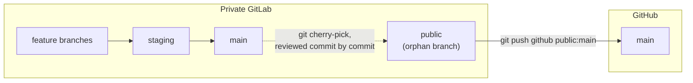

# Release and publishing

## Versioning: CalVer

Every component uses **CalVer** in the form `YYYY.MM.PATCH`:

- `YYYY.MM` is set to the year and month a release is cut. There is no obligation
  to release monthly — the date records when it happened.
- `.PATCH` starts at `.0` and increments for fix-only follow-ups within the same
  month.
- Pre-release labels (`-rc1`, `-pre-<name>`) may be appended.

Tags are **bare**, with no `v` prefix.

Components are versioned and released **independently**. There is no combined
"Lagrange 2026.07" release, because every cross-component contract is either a
stable HTTP API or a flag whose default preserves the previous behaviour — so a
deployment can upgrade one component at a time.

## Changelogs

`CHANGELOG.md` in [Keep a Changelog](https://keepachangelog.com/en/1.1.0/) format,
with one rule that matters operationally:

!!! important "**Breaking:** means an operator must act"
    Entries flagged **Breaking:** require action on upgrade — a new environment
    variable, a `docker-compose.yaml` change, a migration to run. Everything else
    can be deployed by pulling and restarting. Someone upgrading a production
    deployment reads only those lines; make them count.

Cutting a release, in every repository:

1. Move the `## [Unreleased]` entries into a new dated section
   `## [YYYY.MM.PATCH] — YYYY-MM-DD`, flagging operator-action items.
2. Add the matching link reference at the bottom of the file.
3. Bump the version — `pyproject.toml` for the gateway, `package.json` for the
   Node/React repositories.
4. Commit (`chore: release <version>`), tag (`git tag -a <version>`), push both.

## Private development, public releases

Development happens on a **private GitLab** instance; the open-source releases live
on **GitHub**. The two are bridged by a curated orphan branch, so that internal
history — internal host names, deployment details, and the ordinary noise of a
private repository — never reaches the public mirror.



| Branch | Lives on | Pushed to |
|---|---|---|
| feature branches | GitLab | GitLab only |
| `staging` | GitLab | GitLab only — integration before `main` |
| `main` | GitLab | GitLab only |
| `public` | both | `origin public` and `github main` |

**`public` is an orphan branch.** Its history begins at a clean
"Initial public release" squash commit and contains none of the pre-release private
history. It is advanced from `main` **one commit at a time** with `git cherry-pick`.

### Publishing a commit

```bash
git checkout public
git cherry-pick <commit-sha>     # repeat for each commit to publish
git push origin public           # update the GitLab copy of public
git push github public:main      # update GitHub
git checkout main
```

Two rules, and they are what make the model work:

- **Review every cherry-pick before pushing.** The `public` branch is the gate that
  keeps internal details out of the mirror. Nothing lands on it accidentally.
- **Never `git push github main:main`, and never rebase `public` onto `main`.**
  Either would carry the entire private history to GitHub in one irreversible push.

### Which files are published

Not everything on `main` belongs on `public`. The gateway, for example, keeps its
development-deployment compose file, dev environment example and dev deployment
notes off the public branch — they are useful internally and confusing publicly.

The test to apply to each file: **would this make sense to someone who has never
seen our infrastructure?** If it hardcodes a host, an IP, an internal service name
or an institution-specific procedure, it either gets generalised or stays private.

## This documentation site

The same model, with two publishing targets.

| Branch | Purpose | Published to |
|---|---|---|
| `staging` | Where documentation is written and reviewed | nothing |
| `main` | Reviewed content | **GitLab Pages** (internal preview of the full site) |
| `public` | Cherry-picked from `main` | **GitHub Pages**, via `github main` |

Both CI configurations are tracked on all branches: `.gitlab-ci.yml` builds the site
and deploys GitLab Pages from the default branch, and `.github/workflows/pages.yml`
builds and deploys GitHub Pages on push to `main` of the GitHub repository. Keeping
both files everywhere means **`public` stays a strict cherry-picked subset of
`main`** — no branch-only files to reconcile — and a GitHub workflow sitting on a
GitLab branch is simply inert.

The site builds with `mkdocs build --strict`, so a broken internal link or a page
missing from the navigation fails the pipeline rather than shipping.
