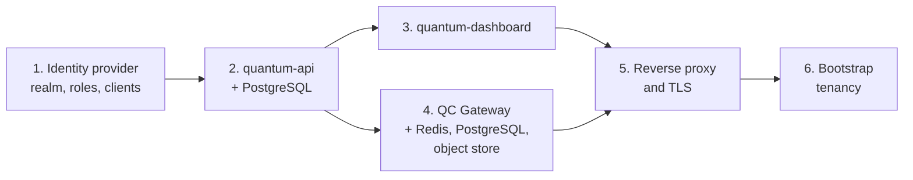

# Deploying component by component

Use this path when you are integrating into existing infrastructure — your own
identity provider, your own PostgreSQL, your own reverse proxy and certificates —
or when you want to know exactly what each component requires. If you just want a
working system, the [one-command stack](portable-deployment.md) is faster and its
installer is a working reference for everything below.

Deploy in this order. Each step is verifiable on its own, and each depends on the
previous one.



## 1. Identity provider

The stack needs an OIDC provider that can issue access tokens with a `realm_access.roles`
claim. Keycloak is what every deployment uses; anything equivalent works if the
token shape matches.

Create:

- **A realm.** Conventionally `cortex`; the name is configuration
  (`KEYCLOAK_REALM`, `KEYCLOAK_ISSUER`), so choose freely.
- **Four realm roles**: `cortex_user`, `pulla_user`, `platform-admin`,
  `platform-ro-admin`. See [realm roles](../architecture/identity.md#realm-roles-what-the-identity-provider-must-provide)
  for what each grants.
- **Two public clients**: one for the dashboard (authorization-code flow, with
  your dashboard origin in the redirect URIs and web origins), one used to obtain
  a token for the machine path. One client can serve both purposes.
- **Users whose username is their e-mail address**, with `email` set and verified.
  This matters: the backend matches identities by e-mail. If your identities are
  not e-mail addresses, see [`USERNAME_FORMAT`](../reference/configuration.md#username_format)
  and set it *before* the backend's first boot.

Grant `cortex_user` to anyone who should be able to submit circuits, `pulla_user`
additionally to start them with sweep access (after first login it is an
administrator's toggle in the dashboard, not the realm's), and `platform-admin` to
your first administrator —
that is the whole bootstrap for platform administration; no database seeding is
required.

Full walk-through, including a script that does all of the above idempotently:
[Identity provider](../components/identity-provider.md).

**Verify:** you can obtain a token and it contains the roles you expect.

```bash
curl -s "https://<idp>/realms/<realm>/protocol/openid-connect/token" \
  -d grant_type=password -d client_id=<client> \
  -d username=<user> --data-urlencode password='<password>' \
  | python3 -c 'import json,sys,base64; t=json.load(sys.stdin)["access_token"]; \
p=t.split(".")[1]; p+="="*(-len(p)%4); print(json.loads(base64.urlsafe_b64decode(p))["realm_access"])'
```

## 2. quantum-api

**Requirements:** Node.js LTS (or Docker), PostgreSQL 17+, and the identity
provider from step 1.

```bash
git clone https://github.com/LINKS-Foundation-CPE/Lagrange-API quantum-api && cd quantum-api
cp .env.example .env      # then edit — see below
npm install
npm run migrate           # apply sequelize-cli migrations
npx tsx ./src/server      # start
```

Or with Docker Compose, which brings its own PostgreSQL:

```bash
docker compose up -d
# native HTTPS on the published port, with a self-signed certificate:
docker compose -f docker-compose.yaml -f docker-compose.tls-dev.yaml up -d
```

Minimum configuration:

```ini
API_PORT=8500
KEYCLOAK_BASE_URL=https://<idp>/auth   # base URL; the realm path is appended
KEYCLOAK_REALM=cortex
BACKEND_SECRET=<long random string>    # HS256 key for platform tokens
CORS_ORIGIN=https://<dashboard-origin> # exact origin, scheme and port included
DB_HOST=<postgres-host>
DB_PORT=5432
POSTGRES_DB=quantum
POSTGRES_USER=quantumapi
POSTGRES_PASSWORD=<password>
# Optional: terminate TLS in the process instead of at a proxy
# SSL_CERT=/path/cert.pem
# SSL_KEY=/path/key.pem
```

Notes:

- **`BACKEND_SECRET` is a symmetric signing key** for the platform tokens the API
  itself issues and verifies. Generate it randomly, keep it to this service, and
  rotate it by restarting the API — in-flight platform tokens become invalid,
  which logs everyone out of the dashboard.
- **`CORS_ORIGIN` must match the dashboard's origin exactly**, including port. A
  mismatch produces a dashboard that loads and then fails every API call — the
  single most common misconfiguration.
- **Migrations plus model sync.** `npm run migrate` applies the migrations in
  `migrations/`; the server additionally runs Sequelize `sync()` on boot, which
  creates any missing tables. On a fresh database either path gets you a working
  schema; on an existing one, always run the migrations.
- **Decide `USERNAME_FORMAT` now.** It is frozen in the database on first boot and
  the server refuses to start later with a conflicting value. The default
  (`email`) is right unless your identities are not e-mail addresses.

The full variable list with defaults is in the
[configuration reference](../reference/configuration.md#quantum-api).

**Verify:**

```bash
curl -sk https://<api>/config                 # → {"slotConstrainedReservations":true}
curl -sk https://<api>/api-docs/ | head -5    # → Swagger UI
curl -sk https://<api>/auth/token -X POST \
     -H "Authorization: Bearer <oidc-token>"  # → {"token":"<platform token>"}
```

The third call is the real test: it exercises JWKS retrieval, signature
validation, user auto-provisioning and role derivation in one shot. It also
creates the user row for that identity.

## 3. quantum-dashboard

**Requirements:** Node.js LTS to build; any static web server to serve.

```bash
git clone https://github.com/LINKS-Foundation-CPE/Lagrange-Dashboard quantum-dashboard && cd quantum-dashboard
cp .env.example .env
npm install
npm run build            # static assets in dist/
```

Configuration is entirely `VITE_*` variables, **baked in at build time** — a
change means a rebuild, not a restart:

```ini
VITE_API_URL=https://<api>/api
VITE_TOKEN_URL=https://<api>/auth/token
VITE_KEYCLOAK_URL=https://<idp>/auth
VITE_KEYCLOAK_REALM=cortex
VITE_KEYCLOAK_CLIENTID=<dashboard client id>
```

Serve `dist/` from your reverse proxy. It is a single-page application, so
unknown paths must fall back to `index.html`.

**Verify:** logging in redirects to the identity provider and back, and the
sidebar contents match the role of the account you used — a plain user sees only
their own projects and jobs, a `platform-admin` sees organizations, slots and
logs.

## 4. QC Gateway

**Requirements:** Docker with Compose. The stack brings up its own PostgreSQL,
Redis, RustFS (object store) and (in the reference `docker-compose.yaml`) an nginx/Let's Encrypt
container. It needs network reachability to the machine, to the identity provider
and to quantum-api.

```bash
git clone https://github.com/LINKS-Foundation-CPE/QC-Gateway && cd QC-Gateway
cp env.example .env      # then edit — see below
./run_middleware.sh production
```

`run_middleware.sh` is a thin wrapper that exports `MIDDLEWARE_MODE` and runs
`docker compose up`. Equivalent:

```bash
MIDDLEWARE_MODE=production docker compose up -d
```

Minimum configuration:

```ini
# What to load
VENDOR_PLUGIN=iqm
SITE_PLUGIN=<your site plugin>
MIDDLEWARE_MODE=production

# Upstream machine — the gateway is the only holder of this token
MACHINE_URL=https://<machine-host>
IQM_SERVER_TOKEN=<machine service token>
VERIFY_UPSTREAM_SSL=true

# Identity provider
KEYCLOAK_ISSUER=https://<idp>/auth/realms/cortex
KEYCLOAK_JWKS_URL=https://<idp>/auth/realms/cortex/protocol/openid-connect/certs

# Where the backend lives (site plugin)
PORTAL_API_HOST=https://<api>

# Public identity of this deployment
BASE_DOMAIN=example.org
FRONTEND_URL=machine.example.org        # also whitelists the CORS origin
JOBS_PORTAL_URL=https://jobs.example.org

# Object store, Redis, local PostgreSQL
MINIO_SERVER_URL=https://store.example.org
BUCKET_NAME=job-data
APP_USER=<object store app user>
APP_PASSWORD=<object store app password>
POSTGRES_PASSWORD=<password>

# Fairness limits
MAX_CONCURRENT_SHOTS=2500000
MAX_CONCURRENT_SWEEPS=10
```

Two processes come up from the same image: the proxy and the reporter. Both need
the same configuration; the reporter additionally honours the
`JOB_REPORTER_*` tuning variables.

Bring it up in `authentication` mode first if the backend is not ready yet: the
gateway will authenticate and proxy without asking anyone for authorization, which
is enough to prove the machine path works. Switch to `production` once
`/jobAuthorizer` answers.

The full variable list is in the
[configuration reference](../reference/configuration.md#qc-gateway); the
authoritative documentation of the request pipeline and the plugin contracts is
`docs/DOCUMENTATION.md` in the gateway repository.

**Verify:**

```bash
curl -sk https://<gateway>/health                                  # public route
curl -sk https://<gateway>/api/v1/quantum-computers                # → 401
curl -sk https://<gateway>/api/v1/quantum-computers \
     -H "Authorization: Bearer <oidc-token>"                       # → the machine's answer
```

The last call proves authentication, RBAC, the route table and upstream
connectivity all work. If it returns `403` with no detail, the route is missing
from the vendor plugin's table or the token lacks `cortex_user`.

## 5. Reverse proxy and TLS

Nothing in the stack requires a particular proxy; the reference deployment uses
nginx with Let's Encrypt, rendering per-service virtual hosts from the templates
in the gateway's `config/nginx/site-confs/`. Each template is named after the
service it fronts and takes every host name from `.env`, so
`bash configure_nginx.sh` produces the vhost set for your domains; drop the
templates for upstreams you do not run. A typical arrangement:

| Public host | Upstream | Serves |
|---|---|---|
| `machine.example.org` | gateway `:8000` | The vendor API. This is the URL users configure in their SDK. |
| `machine.example.org/auth` | identity provider | Keeping the IdP on the same host as the API simplifies token audiences. |
| `api.example.org` | quantum-api `:8500` | The backend, for the dashboard. |
| `dashboard.example.org` | static `dist/` | The dashboard SPA, with SPA fallback. |
| `store.example.org` | object store `:9000` | Artifact links resolve here. |
| `jobs.example.org` | static results portal | Linked from job records. |

Two rules that will otherwise cost you an afternoon:

- **Do not rewrite the `Host` header** on the object-store vhost. Dropping the
  port breaks S3 signature validation and produces `SignatureDoesNotMatch`.
- **If you bring your own object store**, give its bucket the anonymous and CORS
  policies the results portal needs — see
  [The object store](../components/qc-gateway.md#the-object-store).
- **The backend's machine endpoints must not be publicly reachable.**
  `/jobAuthorizer`, `/jobReport` and `/userRoles` are the gateway-to-backend
  contract; restrict them at the proxy to the gateway's address. See
  [the contract reference](../reference/machine-endpoints.md#authentication-status-and-hardening)
  for why this matters today.

## 6. Bootstrap tenancy

Nothing can be submitted until a user is a member of a project with budget. As the
`platform-admin` from step 1, either use the dashboard or drive the API directly:

```bash
TOKEN=$(curl -sk https://<api>/auth/token -X POST \
  -H "Authorization: Bearer <oidc-token>" | python3 -c 'import json,sys;print(json.load(sys.stdin)["token"])')

# 1. An organization — this also creates its vault project, credited with the budget
curl -sk https://<api>/api/organizations -X POST \
  -H "Authorization: Bearer $TOKEN" -H 'Content-Type: application/json' \
  -d '{"name":"ExampleOrg","initial_budget":100,"free_queue":false}'   # initial_budget in HOURS

# 2. A project, funded out of that vault
curl -sk https://<api>/api/projects -X POST \
  -H "Authorization: Bearer $TOKEN" -H 'Content-Type: application/json' \
  -d '{"name":"example-project","organization_id":1,"budget":36000000}'   # budget in QPU-MILLISECONDS

# 3. A member, by e-mail
curl -sk https://<api>/api/projects/1/users -X POST \
  -H "Authorization: Bearer $TOKEN" -H 'Content-Type: application/json' \
  -d '{"email":"user@example.org"}'
```

!!! warning "Two different units in two adjacent calls"
    An organization's `initial_budget` is in **hours** (the backend multiplies by
    3 600 000 before crediting the vault). A project's `budget` is in **raw
    QPU-milliseconds**. This is a wart in the current API, not a subtlety — get
    it wrong and you will fund a project with ten hours' worth of milliseconds,
    or with 36 000 hours.

Then set the user's default project (they can do it themselves from the dashboard
profile, or `PUT /api/own/default_project` as that user) so submissions without an
explicit `project_name` resolve. See the
[HTTP API reference](../reference/quantum-api-http.md) for exact payloads, and
[Tenancy, budgets and billing](../architecture/accounting.md) for the semantics.

`quantum-api/scripts/dev-seed.sh` does all of this through the real API and is a
good template to adapt.

**Verify:** [run a circuit](first-circuit.md).
