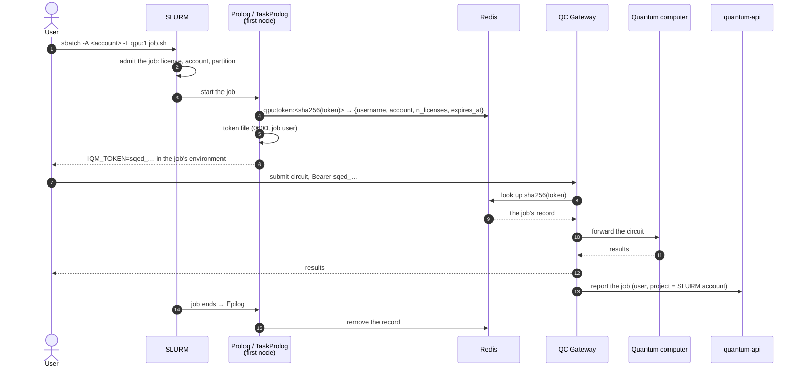

# Sqed: the stack behind SLURM

**Sqed**, the *Slurm-based Quantum Execution Director*, puts the quantum computer
behind an HPC cluster's batch scheduler. Users submit circuits from inside their
SLURM jobs. SLURM decides who may use the machine, how much of it and for how
long, and charges it to an account. The gateway authenticates each job by a token
SLURM minted for it and records the job under that account.

Sqed is not a separate product. It is two parts of the Lagrange stack used
together:

| Part | Where | What it does |
|---|---|---|
| **The SLURM prolog/epilog** | [Lagrange-prolog-epilog](https://github.com/LINKS-Foundation-CPE/Lagrange-prolog-epilog) | Shell scripts run by SLURM. When a job holding the `qpu` license starts, they mint a token, publish its record on Redis and hand the token to the job; when it ends, they remove the record. |
| **The gateway's `sqed` plugins** | [QC Gateway](../components/qc-gateway.md) | The `sqed` **auth plugin** turns a token back into an identity by reading that record. The `sqed` **site plugin** lets those submissions through without asking the portal, since SLURM already admitted the job, and files each job under its SLURM account. |

quantum-api and the dashboard need no Sqed code, only two settings: identities
that are cluster user names, not e-mail addresses, and *job-portal-only* mode, in
which the portal lists jobs but no longer manages projects or budgets.

## When to use it

Use it when the quantum computer is a resource of an HPC centre, and the centre's
scheduler, not the portal, should decide access and keep the accounts. The
default Lagrange deployment, where people log in and spend project budgets, is
unaffected: every Sqed behaviour is behind a setting that is off by default.

## The life of a Sqed job

1. The user submits a batch job requesting the `qpu` license. SLURM admits it
   (or queues it) like any other licensed job.
2. On the job's first node, the **prolog** mints a random `sqed_…` token. It
   writes the job's record to Redis under the token's SHA-256, never under the
   token itself, and stores the token in a file only the job user can read.
3. The **TaskProlog** puts the token in each task's environment as `IQM_TOKEN`,
   which the IQM client libraries read. If there is no token, it fails the task
   at once rather than let it burn its allocation on 401s.
4. The job submits circuits to the gateway as usual, with the token as its bearer
   credential. The gateway's `sqed` auth plugin hashes the token and reads the
   record: the job's user name, its SLURM account, the licenses it holds and
   when it expires.
5. The `sqed` site plugin **skips the portal's job authorization** for these
   submissions: SLURM already granted the license. The gateway's fair-use limits
   still apply. With the `shot_budget` policy plugin, a job's concurrent shots
   scale with the licenses it holds.
6. The gateway reports the job to quantum-api with the **SLURM account as its
   project**, overriding whatever project the client named. The account comes
   from the cluster, not from the client.
7. When the job ends, the **epilog** removes the record. A job that ends without
   an epilog (a crashed node, say) still loses access, when the record's TTL,
   set from the partition's maximum wall time, runs out.

## What changes for users and operators

| | Lagrange (default) | Sqed |
|---|---|---|
| Who may submit | Portal users, by Keycloak login, within project budgets and reservations | Jobs SLURM admitted with the `qpu` license |
| Credential | The user's OIDC token | A per-job token, valid while the job runs |
| Where a job is charged | The project the user names, from its budget | The job's SLURM account; SLURM does the accounting |
| User identity | E-mail address | Cluster user name |
| Portal | Full management: projects, budgets, reservations, reports | A job viewer: users log in and see their own jobs and results |

## Security properties

- **A token is only good while its job runs.** The epilog removes it; the TTL
  removes it anyway if the epilog never runs.
- **Reading Redis does not reveal a usable token.** Records are filed under the
  token's SHA-256, and the gateway hashes whatever it is given, so a digest
  cannot be presented as a token.
- **Only the prolog's node talks to Redis**, once at job start and once at job
  end. Compute nodes and users never do.
- **The account is the cluster's word.** A client cannot charge its jobs to
  another account by naming a different project.

The authoritative statement of the Redis records is the
[prolog/epilog README](https://github.com/LINKS-Foundation-CPE/Lagrange-prolog-epilog#redis-contract).
The gateway side is in its
[documentation](https://github.com/LINKS-Foundation-CPE/QC-Gateway/blob/main/docs/DOCUMENTATION.md).

Next: [Deploying Sqed](deployment.md).
