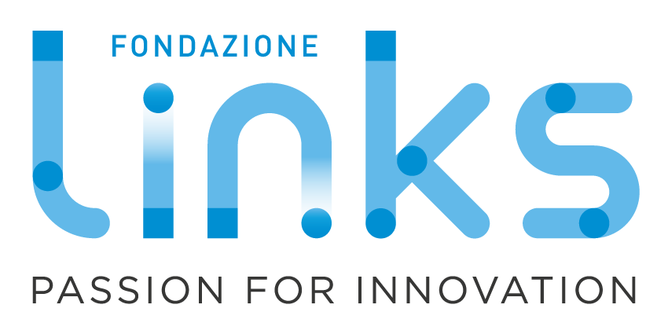

# Lagrange management stack

Technical documentation for the software that turns a single quantum computer into
a governed, multi-tenant, accountable service.

<p style="display: flex; flex-wrap: nowrap; align-items: center; gap: 1.5rem;">
<a href="https://linksfoundation.com"></a>
<a href="https://www.polito.it"></a>
<a href="https://www.inrim.it"></a>
</p>

---

**Lagrange** is the management stack developed by LINKS Foundation to operate
Italy's first publicly-accessible quantum computer. It is a general-purpose
platform layer: nothing in it is specific to one machine, one vendor, or one
institution. Vendor specifics live in plugins, site specifics live in plugins
and configuration, and the core concerns — authentication, authorization,
fair-use limits, tenancy, budgets, reservations, accounting and auditing — are
reusable as they are.

The stack is three cooperating services:

| Component | What it is | Role |
|---|---|---|
| **[QC Gateway](components/qc-gateway.md)** | Python / FastAPI reverse proxy | The **data plane**. Circuits flow through it. Authenticates, authorizes, rate-limits, proxies verbatim to the machine, captures payloads and artifacts, reports jobs for accounting. |
| **[quantum-api](components/quantum-api.md)** | Node.js / TypeScript REST backend | The **control plane** and system of record. Users, organizations, projects, budgets, slots, reservations, job records, billing ledger, audit log. |
| **[quantum-dashboard](components/quantum-dashboard.md)** | React / react-admin SPA | The **management UI** over quantum-api, for operators, principal investigators and end users. |

Plus one external dependency the stack does not implement: an **[OIDC identity
provider](components/identity-provider.md)** (Keycloak in every deployment so
far).

## Where to start

<div class="grid cards" markdown>

-   :material-rocket-launch: **Run it**

    Bring the whole stack up on one Linux box and submit a circuit through it.

    [→ Getting started](getting-started/index.md)

-   :material-sitemap: **Understand it**

    How the pieces fit, who is allowed to do what, and how a job becomes a
    billing entry.

    [→ Architecture](architecture/index.md)

-   :material-view-dashboard-outline: **Use it**

    The management portal page by page: projects, jobs, reservations, budgets,
    reports, and who can see what.

    [→ Using the portal](using/index.md)

-   :material-api: **Integrate with it**

    The HTTP API of the backend and the contract the gateway speaks to it.

    [→ Reference](reference/index.md)

-   :material-code-braces: **Extend it**

    Support a different machine vendor, a different site, or add a resource.

    [→ Development](development/index.md)

</div>

## What this documentation covers

This site documents the **software**: architecture, contracts, configuration,
API surface, and how to deploy and test it yourself. It is written to be
sufficient on its own — you should be able to stand the stack up and run a
circuit through it without access to any private material.

It deliberately does **not** document any particular installation. Host names,
network topology, credentials, backup targets and machine-specific operating
procedures belong to whoever runs a deployment. Examples in these pages use
placeholder values.

Two neighbouring documentation sets exist and are not duplicated here:

- **Per-repository documentation.** Each repository carries its own `README.md`,
  `CONTRIBUTING.md`, `CHANGELOG.md` and — for the gateway — a full architecture
  and plugin reference under `docs/`. This site links to them rather than
  restating them.
- **Deployment-specific end-user documentation.** [Using the
  portal](using/index.md) describes the management interface this software
  provides. Instructions tied to one machine and one institution — how to get an
  account, which queues exist, who to ask — belong to that deployment's own user
  documentation, not here.

## Status and versioning

The stack runs in production on IQM-based superconducting hardware. Every
component is versioned with **CalVer** (`YYYY.MM.PATCH`) and keeps a
`CHANGELOG.md` in [Keep a Changelog](https://keepachangelog.com/en/1.1.0/)
format; entries flagged **Breaking:** require operator action on upgrade.

Components are released independently and are compatible across a range of
versions, because every cross-component contract is either a stable HTTP API or
a configuration flag whose default preserves the previous behaviour. See
[Release and publishing](development/releases.md).

## Licensing and citation

All components are released under the **European Union Public Licence v. 1.2
(EUPL-1.2)**, as is this documentation. See [Licensing](about/licensing.md).

If you use Lagrange in your research, please cite:

```bibtex
@misc{viviani2026lagrangeoperatingitalyspubliclyaccessible,
      title={Lagrange: Operating Italy's First Publicly-Accessible Quantum Computer for Research and Education},
      author={Paolo Viviani and Fabrizio Bertone and Giacomo Vitali and Emanuele Dri and Federico Stirano and Giuseppe Caragnano and Francesco Lubrano and Antonino Nespola and Olivier Terzo and Matteo Cocuzza and Bartolomeo Montrucchio and Giovanna Turvani and Gianluca Bertaina and Marco Coisson and Davide Calonico and Fabrizio Pirri and Pietro Asinari},
      year={2026},
      eprint={2604.21695},
      archivePrefix={arXiv},
      primaryClass={quant-ph},
      url={https://arxiv.org/abs/2604.21695},
}
```
