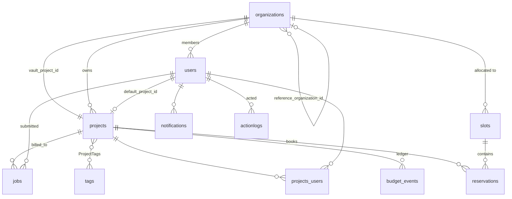

# Database schema

The schema of **quantum-api**, the system of record. Managed with `sequelize-cli`
migrations under `migrations/`; the models in `src/models/` are the authoritative
definitions and Sequelize `sync()` creates any missing tables at boot.

The gateway's own PostgreSQL is a separate, operational job log and is not covered
here — it can be rebuilt without touching accounting data.

## Entity relationships



## Tables

### `users`

| Column | Type | Notes |
|---|---|---|
| `id` | integer PK | |
| `email` | string, **unique**, not null | **The identity.** An e-mail address, or any whitespace-free string when `USERNAME_FORMAT=any`. This is what the gateway reports as a job's `username`. |
| `sub` | string, unique, nullable | Identity-provider subject. `null` until first login, then back-filled and used as the primary match. |
| `organization_id` | integer, nullable | |
| `default_project_id` | integer, nullable | Used when a submission names no project. |
| `organization_manager` | boolean, default false | Derives the `organization-manager` platform role. |
| `organization_auditor` | boolean, default false | Derives the `organization-auditor` platform role. |
| `pulla_user` | boolean, default false | "Pulse access" — sweep submission. Consulted by `POST /jobAuthorizer` for a `sweep` and reported by `GET /userRoles`. Seeded from the identity provider when the row is created; set by platform administrators thereafter. |

Rows are created either by an administrator or automatically at first token
exchange. A user with no organization and no project membership is valid and can do
nothing.

### `organizations`

| Column | Type | Notes |
|---|---|---|
| `id` | integer PK | |
| `name` | string, not null | |
| `reference_organization_id` | integer, nullable | Another organization whose slots this one may also book into. |
| `vault_project_id` | integer, nullable | The project holding this organization's undistributed budget. Set immediately after creation. |

### `projects`

| Column | Type | Notes |
|---|---|---|
| `id` | integer PK | |
| `name` | string, **unique**, not null | Platform-wide unique. This is the `project_name` users submit with. |
| `remaining_budget` | **bigint**, not null, default 0 | QPU-milliseconds. Serialised as a **JSON string** by the API. |
| `start_at` / `end_at` | timestamp, nullable | Validity window; submissions outside it are refused. |
| `free_queue` | boolean, default false | Never billed, budget never consulted. |
| `organization_id` | integer, not null | |
| `total_freequeue_time` | *virtual* | Computed, not stored. |

A vault project is an ordinary row; what makes it a vault is being referenced by
`organizations.vault_project_id`.

### `projects_users`

| Column | Type | Notes |
|---|---|---|
| `id` | integer PK | |
| `user_id`, `project_id` | integer | **Unique together.** |
| `admin` | boolean, default false | `true` = principal investigator. Any such row gives the user the `project-admin` platform role. |

No timestamps on this table.

### `tags`

A controlled vocabulary of project labels.

| Column | Type | Notes |
|---|---|---|
| `id` | integer PK | |
| `name` | string, **unique**, not null | Trimmed, at most 64 characters by the API's schema. |

### `ProjectTags`

The many-to-many join between `projects` and `tags`. Created by Sequelize from
the association, which is why its name and columns are camel-cased where every
other table is snake-cased — worth knowing when writing SQL against it, since
the identifiers must be quoted.

| Column | Type | Notes |
|---|---|---|
| `"projectId"`, `"tagId"` | integer | **Composite primary key.** Both cascade on update and on delete. |
| `"createdAt"`, `"updatedAt"` | timestamp, not null | |

The cascade is the reason deleting a tag that is still assigned is refused by the
API with `409` rather than left to the database: the foreign key would happily
remove the assignments, and the vocabulary should not drop a label out from under
the projects using it without saying so.

### `slots`

| Column | Type | Notes |
|---|---|---|
| `id` | integer PK | |
| `organization_id` | integer, not null | |
| `day` | date, not null | |
| `start` / `end` | timestamp, not null | |

An allocation of machine time to an organization. Books nothing by itself.

### `reservations`

| Column | Type | Notes |
|---|---|---|
| `id` | integer PK | |
| `project_id` | integer, not null | The project that has exclusive access. |
| `made_by` | integer, not null | Who booked it. |
| `slot_id` | integer, **nullable** | The containing slot. `null` when the deployment allows free placement (`SLOT_CONSTRAINED_RESERVATIONS=false`). |
| `day` | date, not null | |
| `start` / `end` | timestamp, not null | |
| `description` | string, nullable | Prefixed with the project name at creation. |

Overlapping reservations are rejected at creation. There is no database constraint
enforcing that — it is a service-level check.

### `budget_events` — the ledger

| Column | Type | Notes |
|---|---|---|
| `id` | integer PK | |
| `project_id` | integer, not null | |
| `value` | **bigint** | Signed QPU-milliseconds. Serialised as a **JSON string**. |
| `date` | timestamp, default now | |
| `description` | string | Human-readable provenance. |
| `billing` | boolean, default true | `true` = QPU consumption or refund; `false` = administrative movement (vault creation, transfer). |

**Append-only by convention.** Every change to `projects.remaining_budget` is
accompanied by a row here in the same transaction. Reports are built from this
table, not from the balances.

### `jobs`

| Column | Type | Notes |
|---|---|---|
| `id` | integer PK | Internal. |
| `jobid` | string, not null | The **machine's** job id — the key everything else uses. |
| `organization_id` | integer, not null | Denormalised from the project, for organization-scoped queries. |
| `project_id` | integer, not null | Billed to. |
| `user_id` | integer | Submitter. |
| `status` | string, nullable | Vendor status string. |
| `job_type` | string, default `circuit` | |
| `execution_start` / `execution_end` | timestamp, nullable | The machine's execution window. **Their difference is the billed amount.** Both being present is also the idempotency marker for the terminal report. |
| `submitted_datetime` | timestamp, nullable | |
| `submitted_circuit` | string, nullable | URL of the archived payload. |
| `results` | string, nullable | URL of the results page. |
| `usedReservation` | boolean, default false | Ran inside a reservation, so it is not billed again. |

Written only by the machine endpoints, never through `/api/*`.

### `system_configs`

| Column | Type | Notes |
|---|---|---|
| `key` | string PK | |
| `value` | string, not null | |
| `createdAt` / `updatedAt` | timestamp | |

Deployment decisions frozen at first boot. Currently one key,
`username_format` — see [`USERNAME_FORMAT`](configuration.md#username_format). The
server **refuses to start** if the environment contradicts a frozen value.

### `notifications`

| Column | Type | Notes |
|---|---|---|
| `id` | integer PK | |
| `user_id` | integer, not null | |
| `timestamp` | timestamp, default now | |
| `type`, `title` | string | |
| `description` | text | |
| `read` | boolean, default false | |

Generated by the system — logins, reservation changes affecting the user's
projects.

### `announcements`

| Column | Type | Notes |
|---|---|---|
| `id` | integer PK | |
| `made_by` | integer | |
| `start` / `end` | timestamp, nullable | Display window; `GET /api/activeAnnouncements` returns those containing now. |
| `title` | string | |
| `description` | text | |

### `actionlogs` — the audit trail

| Column | Type | Notes |
|---|---|---|
| `id` | integer PK | |
| `timestamp` | timestamp | |
| `user_id` | integer, nullable | `null` for system-originated entries such as reporting errors. |
| `action` | string | `login`, `registration`, `create`, `update`, `delete`, `reportingError`, `reportingWarning`. |
| `resource` | string | Affected resource type. |
| `resource_id` | integer | |
| `description` | text | Human-readable summary. |

### Legacy tables

`organization_roles` and `tags` exist as models but are not part of the active role
model — organization- and project-scoped roles are the boolean flags on `users` and
the `admin` flag on `projects_users`. Treat them as historical.

## Invariants not expressed in the schema

These are enforced in services, and anything writing to the database directly must
preserve them:

1. **Every `remaining_budget` change has a matching `budget_events` row, in the
   same transaction.** The ledger is the record; the balance is a cache.
2. **An organization's projects are funded from its vault.** Project creation debits
   the vault and fails if it is short, so an organization cannot over-allocate.
3. **Reservations do not overlap.** Checked at creation, not constrained by the
   database.
4. **A reservation is paid for when it is booked**, and the refund on deletion is
   100 % beyond 24 hours' notice and 25 % inside it. Past reservations cannot be
   deleted.
5. **A job with both execution timestamps is final.** This is what makes terminal
   reports idempotent; do not backfill those columns by hand without understanding
   that.
6. **`jobs.organization_id` is denormalised from the project** and must stay
   consistent with it.
7. **`system_configs` entries are frozen.** Changing `username_format` invalidates
   existing identities and silently changes billing attribution.

## Migrations

```bash
npm run migrate      # apply
```

Migrations live in `migrations/` and are `sequelize-cli` CommonJS files. Rules:

- a change to a model that alters the schema ships with its migration **in the same
  commit**;
- **never edit a released migration** — add a new one;
- additive and nullable wherever possible, so that a migration can be applied to a
  live deployment before the new code is rolled out.

Recent migrations, as an illustration of that style: relaxing
`reservations.slot_id` to nullable (enabling slotless reservations without touching
existing rows), and adding the `system_configs` table plus a nullable
`users.pulla_user` column defaulting to false.
