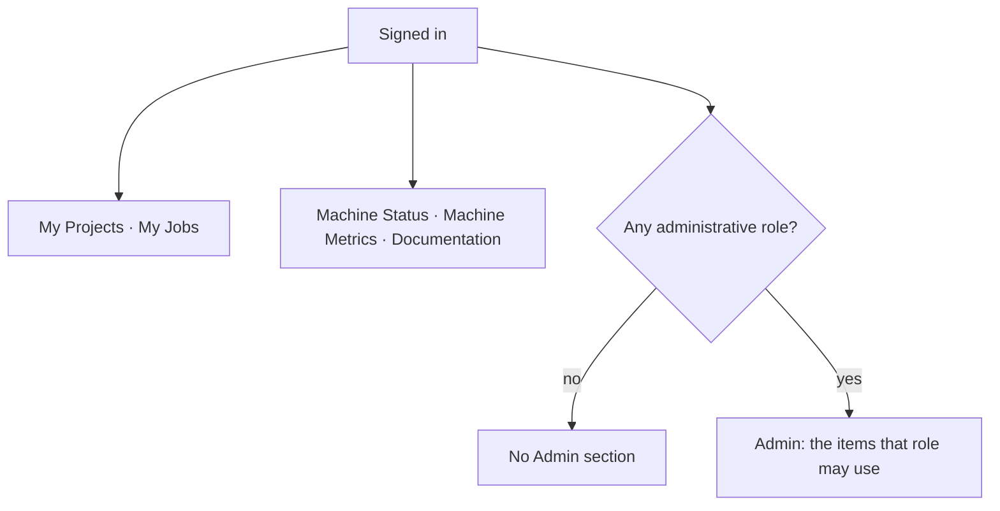

# Using the portal

The portal — [quantum-dashboard](../components/quantum-dashboard.md) — is where
everyone who touches the machine does their non-submission work: seeing which
projects you belong to, how much budget is left, what your jobs did, when the
machine is booked, and, for administrators, managing all of it.

Submitting circuits does not happen here. That goes through the vendor SDK to
the [QC Gateway](../components/qc-gateway.md); see
[Running your first circuit](../getting-started/first-circuit.md). The portal is
what surrounds it.

These pages describe the interface as it behaves, page by page:

- **[Day-to-day use](day-to-day.md)** — what any signed-in user has: projects,
  jobs and their artifacts, machine status, the profile page and the token the
  SDK needs.
- **[Administration](administration.md)** — the Admin section: reservations,
  projects and membership, users, budgets, slots, tags, billing reports, the
  audit log and announcements.

## The sidebar has two halves

Everything above the **Admin** header is personal: it shows *your* projects and
*your* jobs, and every account has it. The Admin section appears only for an
account with some administrative capability, and each item inside it has its own
gate.

| Sidebar item | Who sees it |
|---|---|
| Dashboard (landing) | everyone |
| My Projects, My Jobs | everyone |
| Machine Status, Machine Metrics | everyone, when the deployment configures the URL |
| Documentation | everyone, when the deployment configures the URL |
| **Admin** — Reservations, Reservations Calendar | platform admins, organization managers, project admins |
| **Admin** — Projects | platform admins, organization managers, project admins |
| **Admin** — Users | platform admins, organization managers |
| **Admin** — All Jobs | platform admins |
| **Admin** — Allocated slots, Slots Calendar | platform admins, and only where the deployment is slot-constrained |
| **Admin** — Organizations | platform admins |
| **Admin** — Billing reports | platform admins, organization managers, organization auditors |
| **Admin** — Tags | platform admins |
| **Admin** — Logs, Announcements | platform admins |

Rows are then narrowed by the backend, which is the part that matters: a
principal investigator opening **Projects** sees the projects they administer, an
organization manager sees their organization, a platform admin sees everything.
The same list page serves all three.

!!! note "The interface is a convenience, not the boundary"
    The sidebar hides what a role cannot use, and forms hide fields a role
    cannot set, but none of that is the enforcement — every rule is applied
    again by [quantum-api](../components/quantum-api.md) on the request. Reaching
    a hidden page by URL produces an empty list or a 403, not access. When this
    documentation says who can do something, it is describing the backend rule;
    the UI follows it.

## Roles, briefly

| Role | Scope |
|---|---|
| Platform admin | Everything. `readOnlyAdmin` is the same visibility without writes. |
| Organization manager | Their own organization: its projects, users and reports. |
| Organization auditor | Their own organization's billing reports, read-only. |
| Project admin (PI) | The projects they administer: membership, tags, reservations. |
| User | Their own projects and jobs. |

Roles are not edited in the portal by hand — they come from the identity
provider and are mirrored into the platform token. See
[Identity and authorization](../architecture/identity.md).

## Two conventions worth knowing before you start

**"Username" is the identity field.** It is labelled Username throughout the UI
and stored in `users.email`, because deployments exist where identities are not
e-mail addresses. See
[`USERNAME_FORMAT`](../reference/configuration.md#username_format).

**Budgets and job durations are QPU time.** Budgets are denominated in
milliseconds of machine time, not currency, and are shown as durations. What
debits them is described in
[Tenancy, budgets and billing](../architecture/accounting.md).
